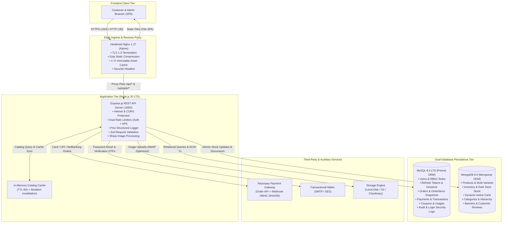
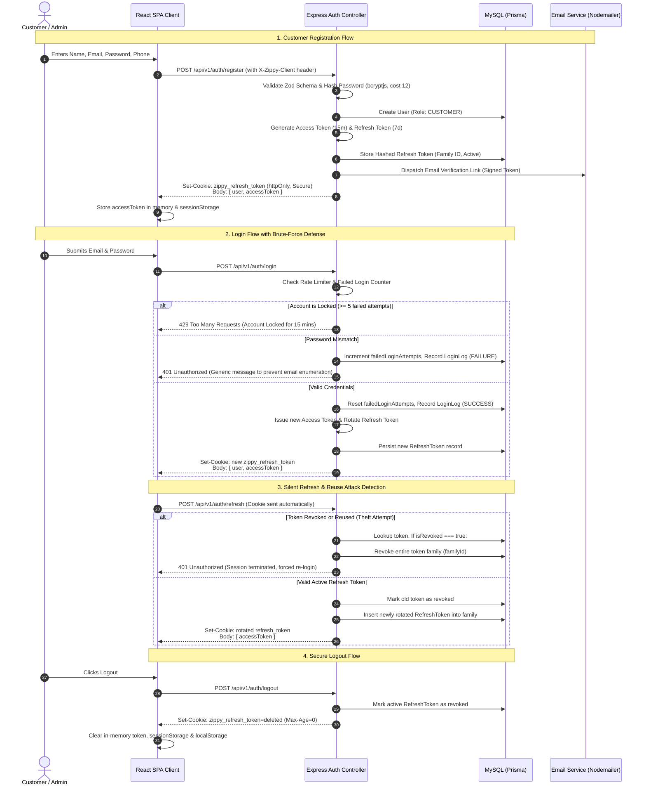
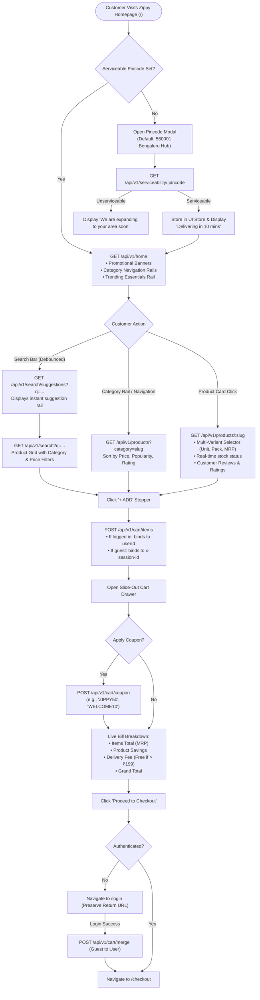
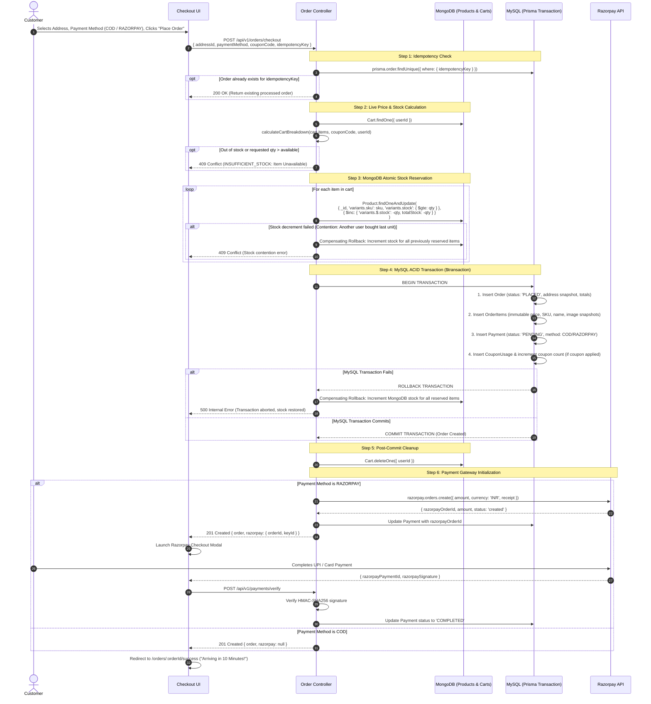
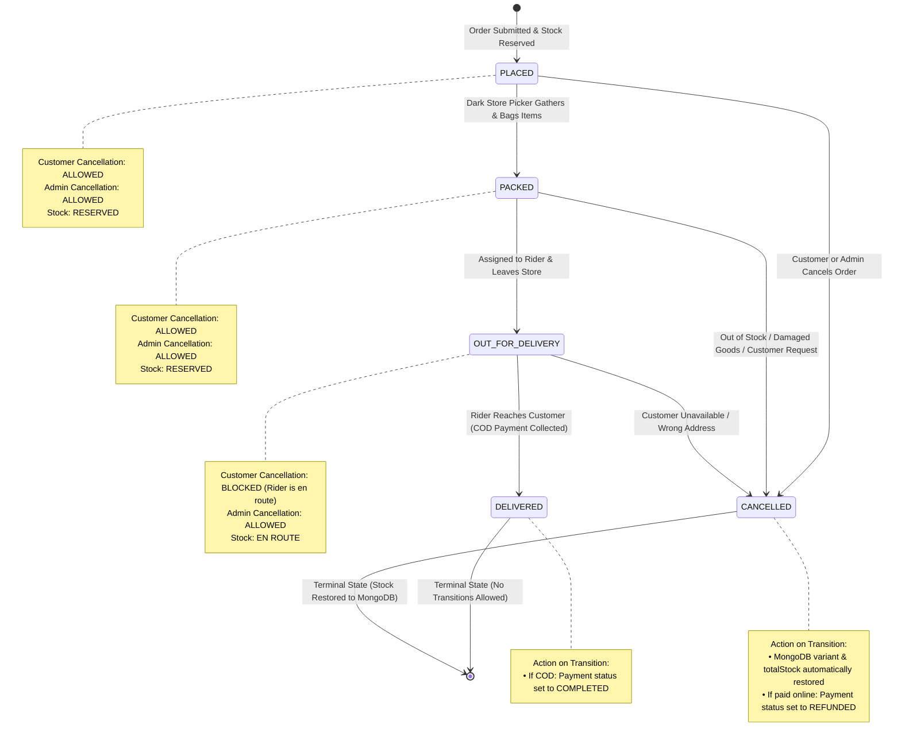
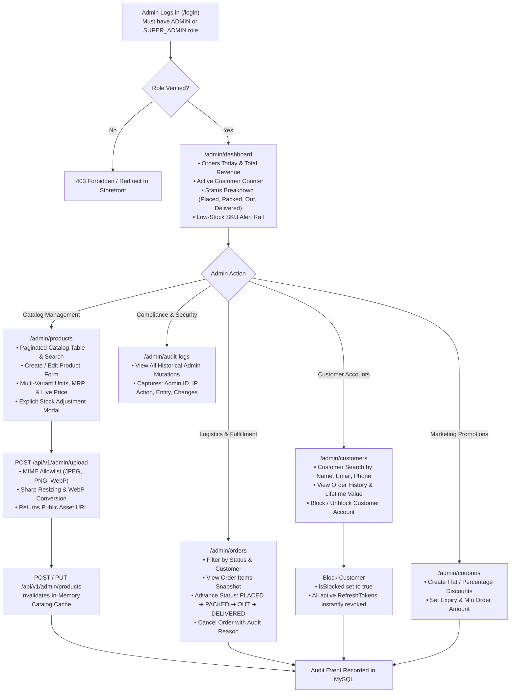
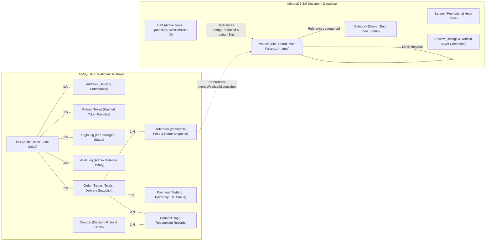

# Zippy: Complete Application Flow & Architecture Guide

> **Author:** Antigravity Team & Mohd Hamza Shaikh  
> **System Name:** Zippy (10-Minute Quick Commerce Platform)  
> **Architecture Pattern:** Dual-Database Event-Driven MERN Monorepo  
> **Target Release:** v1.0.0 (Production Ready)

---

## Table of Contents

1. [System Architecture](#1-system-architecture)
2. [Authentication & Security Flow](#2-authentication--security-flow)
3. [Customer Shopping Journey](#3-customer-shopping-journey)
4. [Checkout, Payment & Atomic Stock Sequence](#4-checkout-payment--atomic-stock-sequence)
5. [Order Status State Machine](#5-order-status-state-machine)
6. [Admin Backoffice Workflow](#6-admin-backoffice-workflow)
7. [Dual-Database Split Rationale & Data Flow](#7-dual-database-split-rationale--data-flow)
8. [Monorepo Directory Structure](#8-monorepo-directory-structure)
9. [Operations Handbook (Local Run, Deployment & Debugging)](#9-operations-handbook)
10. [Future Improvements Roadmap](#10-future-improvements-roadmap)

---

## 1. System Architecture

Zippy employs a decoupled, multi-tiered architecture orchestrated via Docker Compose and Nginx. Traffic enters through Nginx, which serves static frontend assets directly with 1-year immutable caching and reverse-proxies RESTful API requests to the Express.js backend. The backend bridges a dual-database persistence layer: MySQL 8.4 for ACID-critical transactional data and MongoDB 8.0 for catalog and dynamic document data.



---

## 2. Authentication & Security Flow

Authentication uses a hardened, dual-token architecture:

- **Access Tokens:** Short-lived (15 minutes), signed via `HMAC-SHA256`, stored strictly in browser memory and tab-scoped `sessionStorage`.
- **Refresh Tokens:** Long-lived (7 days), stored in an `httpOnly, Secure, SameSite=Lax` cookie. Refresh tokens are hashed using SHA-256 before persistence in MySQL and rotated on every use.
- **Token Family Reuse Detection:** If an already-rotated token is presented (indicating token theft), the entire family of tokens for that user is immediately revoked.
- **CSRF Defense:** Custom header enforcement (`X-Zippy-Client: web` and `X-Requested-With: XMLHttpRequest`) prevents cross-site browser exploits.



---

## 3. Customer Shopping Journey

The customer discovery experience is engineered for sub-second responses and instant delivery verification:



---

## 4. Checkout, Payment & Atomic Stock Sequence

Zippy ensures zero overselling across high-concurrency demand surges. Stock is decremented atomically in MongoDB with a conditional `$gte` check. If the subsequent MySQL transaction fails, MongoDB stock is automatically restored via a compensating rollback.



---

## 5. Order Status State Machine

The order fulfillment workflow models an instant 10-minute dispatch life-cycle:



---

## 6. Admin Backoffice Workflow

Backoffice administrative operations are restricted to `ADMIN` and `SUPER_ADMIN` roles via `RoleRoute` in React Router and `requireRole` on the API:



---

## 7. Dual-Database Split Rationale & Data Flow

### 7.1 Why Dual-Database?

| Criterion                      | MySQL 8.4 (Prisma ORM)                                                                                           | MongoDB 8.0 (Mongoose ODM)                                                            |
| :----------------------------- | :--------------------------------------------------------------------------------------------------------------- | :------------------------------------------------------------------------------------ |
| **Primary Domain**             | Relational, transactional, financial, and security data                                                          | Catalog, inventory, dynamic documents, dynamic carts                                  |
| **ACID Transactions**          | Multi-table ACID transactions for order placement, item snapshots, payments, and coupons                         | Document-level atomic operators (`$inc`, `$set`, `$push`) for fast stock reservations |
| **Data Integrity**             | Foreign key constraints prevent orphaned records (e.g. order without user)                                       | Schema flexibility allows multi-variant product attributes (grams, ml, kg, bundles)   |
| **Order History Immutability** | Order items store **snapshots** (name, price, SKU, image) so historical orders never change if a product updates | Products evolve dynamically with changing prices, descriptions, and images            |
| **Read/Write Profile**         | High integrity, strictly consistent writes                                                                       | High throughput, sub-millisecond reads for catalog browsing                           |

### 7.2 Entity Mapping Matrix



---

## 8. Monorepo Directory Structure

Zippy is structured as an enterprise pnpm workspace monorepo:

```
zippy/
├── .github/
│   ├── dependabot.yml              # Weekly dependency & security update schedules
│   └── workflows/
│       └── ci.yml                  # GitHub Actions CI: lint, audit, db-test, build, deploy
├── client/                         # Frontend Client Application (React 18 + Vite)
│   ├── src/
│   │   ├── components/
│   │   │   ├── auth/               # Route guards (ProtectedRoute, RoleRoute)
│   │   │   ├── cart/               # CartDrawer & Bill breakdown
│   │   │   ├── common/             # Header, Footer, BottomNav, ErrorBoundary
│   │   │   ├── product/            # ProductCard, VariantSelector, ReviewList
│   │   │   └── ui/                 # Accessible UI Kit (Button, Input, Modal, Toast, Badge)
│   │   ├── hooks/                  # Custom React hooks (useCart, useDebounce)
│   │   ├── layouts/                # RootLayout (Storefront) & AdminLayout (Backoffice)
│   │   ├── pages/
│   │   │   ├── admin/              # Lazy-loaded Backoffice pages (Dashboard, Products, Orders)
│   │   │   ├── auth/               # Login, Register, ForgotPassword, ResetPassword
│   │   │   ├── checkout/           # CheckoutPage (Address selection, COD, Razorpay)
│   │   │   ├── orders/             # OrderSuccessPage, OrdersListPage, OrderDetailPage
│   │   │   ├── profile/            # Customer ProfilePage
│   │   │   └── HomePage.jsx        # Landing storefront with category rails & banners
│   │   ├── services/               # HTTP client (apiFetch, silent refresh, queryClient)
│   │   ├── stores/                 # Zustand state stores (authStore, uiStore)
│   │   ├── App.jsx                 # Application entry with QueryClient & ErrorBoundary
│   │   ├── router.jsx              # React Router v6 code-split route configuration
│   │   └── main.jsx                # DOM mounting & Tailwind style imports
│   ├── Dockerfile                  # Hardened Nginx multi-stage build (USER nginx)
│   ├── package.json                # Client dependencies & scripts
│   └── vite.config.js              # Vite bundler, proxy configuration & chunk splitting
├── server/                         # Backend REST API Service (Node.js 20 LTS + Express)
│   ├── prisma/
│   │   ├── migrations/             # Versioned SQL migration history
│   │   └── schema.prisma           # Prisma schema definition (MySQL 8.4)
│   ├── src/
│   │   ├── config/                 # Env validation (Zod), Logger (Pino), Swagger
│   │   ├── controllers/            # Route controllers (auth, product, cart, order, admin)
│   │   ├── database/               # Database connectors (prisma.js, mongo.js, seed.js)
│   │   ├── middleware/             # Auth (JWT), RateLimiters, ErrorHandler, RequestID
│   │   ├── models/                 # Mongoose schemas (Product, Category, Cart, Banner)
│   │   ├── routes/v1/              # Versioned API routes (/auth, /products, /cart, /admin)
│   │   ├── services/               # External adapters (email, payment, serviceability, storage)
│   │   ├── utils/                  # Cryptography (tokens, passwords), Cache, ErrorTracker
│   │   ├── validation/             # Zod validation schemas for all incoming HTTP payloads
│   │   ├── app.js                  # Express middleware chain & route mounting
│   │   └── server.js               # HTTP listener & graceful shutdown handlers
│   ├── Dockerfile                  # Production multi-stage Dockerfile (USER node)
│   └── package.json                # Server dependencies & scripts
├── docker/
│   └── nginx/
│       ├── default.conf            # Virtual host, reverse proxy, SPA fallback, TLS template
│       └── nginx.conf              # Main Nginx process, gzip compression, and event loop
├── docs/
│   ├── DEPLOYMENT.md               # Production deployment runbook & cloud platform guides
│   ├── APPLICATION_FLOW.md         # Comprehensive system architecture & Mermaid diagrams
│   └── phases/                     # Historical logs for Phases 0 through 13
├── e2e/
│   ├── 1-customer-journey.spec.js  # Playwright E2E: Signup, Pincode, Browse, Cart, COD checkout
│   └── 2-admin-journey.spec.js     # Playwright E2E: Super Admin Login, Product CRUD, Status Update
├── scripts/
│   └── load-test.js                # Autocannon benchmark script (Throughput, Latency, Errors)
├── docker-compose.yml              # Local development compose stack
├── docker-compose.prod.yml         # Production compose stack (MySQL, Mongo, Server, Nginx)
├── package.json                    # Monorepo root manifest (scripts & dev tools)
├── pnpm-workspace.yaml             # pnpm workspace definition
└── playwright.config.js            # Playwright configuration with web server orchestration
```

---

## 9. Operations Handbook

### 9.1 How to Run Locally on Windows

1. **Prerequisites Check:**
   - Node.js v20+ and pnpm (`corepack enable && corepack prepare pnpm@latest --activate`).
   - MySQL 8.0+ running on port `3306` with database `zippy_dev`.
   - MongoDB 7.0+ running on port `27017` with database `zippy_dev`.

2. **Environment Setup:**

   ```powershell
   # Copy development environment template
   Copy-Item .env.development .env
   ```

3. **Install Dependencies & Initialize Databases:**

   ```powershell
   # 1. Install all monorepo dependencies
   pnpm install

   # 2. Generate Prisma Client & Run MySQL Migrations
   pnpm --filter @zippy/server prisma:generate
   pnpm --filter @zippy/server prisma:migrate

   # 3. Seed MongoDB Catalog and MySQL Super Admin
   pnpm seed
   ```

4. **Start Development Servers:**
   ```powershell
   # Launches backend (:5000) and frontend (:5173) concurrently
   pnpm dev
   ```

### 9.2 How to Deploy to Production

#### Option A: Linux VPS via Docker Compose (Recommended)

```bash
# 1. Clone repository to /opt/zippy
git clone https://github.com/your-org/zippy.git /opt/zippy && cd /opt/zippy

# 2. Configure production environment
cp .env.production.example .env
nano .env  # Enter your actual production domain and generated secrets

# 3. Obtain initial Let's Encrypt SSL certificate
sudo certbot certonly --standalone -d zippy.yourdomain.com

# 4. Launch the production stack
docker compose -f docker-compose.prod.yml up -d --build

# 5. Run migrations and seed production catalog
docker compose -f docker-compose.prod.yml exec server npx prisma migrate deploy
docker compose -f docker-compose.prod.yml exec server node src/database/seed.js
```

#### Option B: Render or Railway Managed Platforms

- Connect your GitHub repository.
- Deploy `@zippy/server` via `server/Dockerfile` pointing to managed MySQL and MongoDB Atlas instances.
- Deploy `@zippy/client` as a static site using `pnpm build` with SPA rewrites to `/index.html`.

### 9.3 Troubleshooting Common Operational Issues

| Issue / Symptom                         | Root Cause                                                          | Solution                                                                                                                              |
| :-------------------------------------- | :------------------------------------------------------------------ | :------------------------------------------------------------------------------------------------------------------------------------ |
| **`EADDRINUSE: port 5000`**             | Another Node process or previous dev server is running on port 5000 | In PowerShell: `Get-Process -Id (Get-NetTCPConnection -LocalPort 5000).OwningProcess \| Stop-Process -Force`                          |
| **`401 Unauthorized` on Token Refresh** | Missing custom client header or expired refresh cookie              | Ensure `apiFetch` attaches `X-Zippy-Client: web`. In production, verify `COOKIE_SECURE=true` is used exclusively over HTTPS.          |
| **Prisma Migration Desynchronization**  | Database schema modified outside migration files                    | Run `pnpm --filter @zippy/server prisma:status` and resolve drift with `prisma migrate resolve`.                                      |
| **Sharp Image Native Library Error**    | Node.js native compilation mismatch on Alpine Linux                 | Ensure `libc6-compat` is installed in the Docker image. In local Windows, reinstall with `pnpm rebuild --filter @zippy/server sharp`. |
| **Empty Cart Alert on Checkout**        | Browsing as guest before login without session cart merge           | The backend automatically merges guest cart (`x-session-id`) into the user cart during checkout if the user cart is empty.            |

---

## 10. Future Improvements Roadmap

The modular architecture of Zippy is designed for rapid expansion:

1. **Distributed Caching & Shared Rate Limiting (Redis):**
   - Replace the in-memory catalog cache with an enterprise Redis Cluster.
   - Utilize `rate-limit-redis` to share rate-limiting quotas across multiple horizontal API server replicas.
2. **Real-Time Delivery Partner Fleet App:**
   - Build a lightweight React Native or Flutter mobile application for dark-store pickers and delivery riders.
   - Dispatch push notifications when an order enters `PACKED` state.
3. **Live Geolocation Map Tracking (WebSockets / SSE):**
   - Stream driver latitude/longitude updates via Server-Sent Events (SSE) or WebSockets directly to the customer's Order Tracking screen (`/orders/:orderId`).
4. **Multi-Dark Store Geofencing & Inventory Partitioning:**
   - Partition MongoDB product stock by `darkStoreId`.
   - Route customer orders to the nearest dark store within a 3km radius using MongoDB `$geoNear` indexing.
5. **Omnichannel Customer Notifications:**
   - Integrate WhatsApp Business API and SMS gateways (Twilio / Gupshup) for live order delivery updates.

---

_End of Application Flow Documentation._
