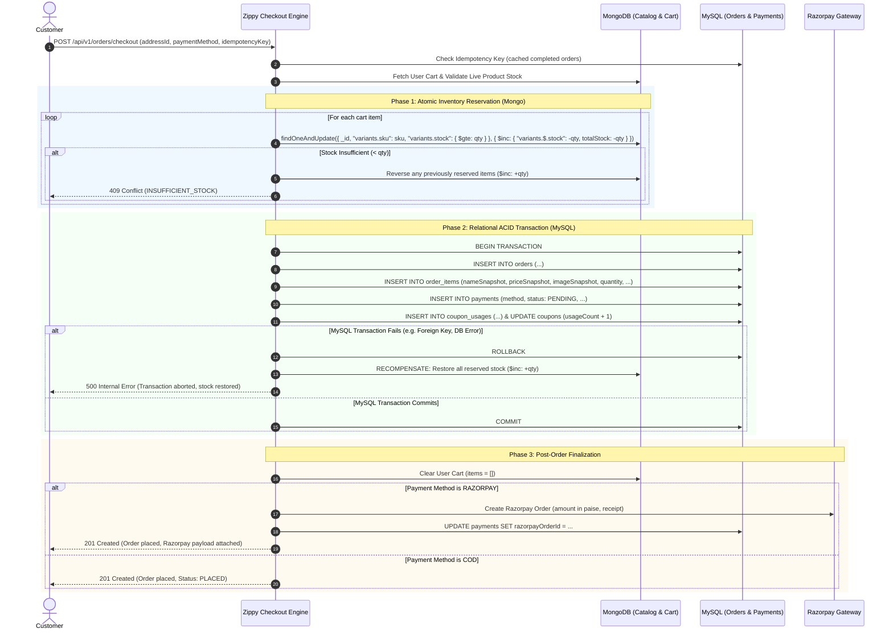
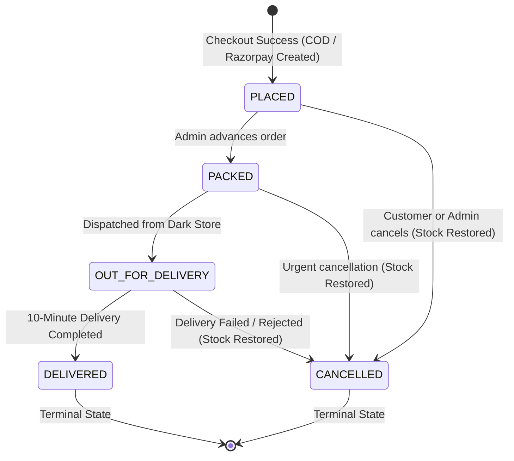

# Phase 5: Cart, Checkout, Orders, and Payments

## Goal

Design and implement the high-reliability transaction processing core for **Zippy**, handling:

1. **Cart Lifecycle (`/api/v1/cart`):** Guest session carts (`x-session-id`), authenticated customer carts, real-time recalculation, out-of-stock validation, discount application, and frictionless guest-to-user cart merging upon login/registration.
2. **Address Management (`/api/v1/addresses`):** Full CRUD for customer delivery addresses with 6-digit Indian PIN code validation, phone formatting, single-default toggling, and soft deletion.
3. **Public Coupons & Promotion Engine (`/api/v1/coupons`):** Active coupon discovery, prospective subtotal validation, min-order threshold checking, usage limits, and user-level redemption enforcement.
4. **Cross-Database Atomic Stock Decrement & Transactional Checkout (`/api/v1/orders/checkout`):**
   - Atomic inventory reservation in MongoDB (`variants.stock: { $gte: quantity }`) guaranteeing zero overselling under heavy concurrency.
   - Idempotent order creation in MySQL via Prisma transaction (`Order`, `OrderItem` snapshot, `Payment`, `CouponUsage`).
   - Automatic rollback and compensation restoring MongoDB stock if any step fails.
5. **Simulated & Live Razorpay Payment Gateway (`/api/v1/payments`):**
   - Dev/test mode deterministic order creation and HMAC-SHA256 signature verification without requiring external network connectivity.
   - Asynchronous Razorpay webhook processing (`payment.captured`, `payment.failed`) with automated stock reclamation on failure or order abandonment.
6. **Order State Machine & Administrative Transitions (`/api/v1/orders/:id/status`):**
   - Strict transition constraints: `PLACED` &rarr; `PACKED` &rarr; `OUT_FOR_DELIVERY` &rarr; `DELIVERED`, with cancellations allowed only prior to dispatch (`PLACED` / `PACKED`).
   - Customer-initiated cancellations with automated inventory replenishment.
7. **Concurrency Verification:** Automated test asserting that when two users simultaneously submit checkout for the last remaining unit of an item, exactly one succeeds (201) and one fails (409), leaving database stock at exactly zero.

---

## Architecture & Data Flow

### Cross-Database Atomicity & Rollback

Because Zippy utilizes a dual-database architecture (MongoDB for high-velocity catalog/cart data and MySQL for relational ACID transactions), cross-engine two-phase commits (2PC) are handled through application-level transactional orchestration:



### Order Status State Machine



---

## API Endpoints Implemented

### 1. Cart (`/api/v1/cart`)

| Method   | Endpoint                        | Auth     | Description                                                      |
| -------- | ------------------------------- | -------- | ---------------------------------------------------------------- |
| `GET`    | `/api/v1/cart`                  | Optional | Retrieve current cart with real-time price & stock recomputation |
| `POST`   | `/api/v1/cart/items`            | Optional | Add item to cart (validates available stock)                     |
| `PATCH`  | `/api/v1/cart/items`            | Optional | Update cart item quantity                                        |
| `DELETE` | `/api/v1/cart/items/:productId` | Optional | Remove item from cart                                            |
| `DELETE` | `/api/v1/cart`                  | Optional | Empty cart                                                       |
| `POST`   | `/api/v1/cart/coupon`           | Optional | Apply coupon code to cart                                        |
| `DELETE` | `/api/v1/cart/coupon`           | Optional | Remove applied coupon from cart                                  |
| `POST`   | `/api/v1/cart/merge`            | Required | Merge guest cart items into authenticated user account           |

### 2. Addresses (`/api/v1/addresses`)

| Method   | Endpoint                        | Auth     | Description                                          |
| -------- | ------------------------------- | -------- | ---------------------------------------------------- |
| `GET`    | `/api/v1/addresses`             | Required | List active delivery addresses for current customer  |
| `POST`   | `/api/v1/addresses`             | Required | Create delivery address (validates 6-digit PIN code) |
| `GET`    | `/api/v1/addresses/:id`         | Required | Get single address by UUID                           |
| `PUT`    | `/api/v1/addresses/:id`         | Required | Update existing delivery address                     |
| `PATCH`  | `/api/v1/addresses/:id/default` | Required | Set address as default (unsets previous default)     |
| `DELETE` | `/api/v1/addresses/:id`         | Required | Soft-delete address (`deletedAt`)                    |

### 3. Coupons (`/api/v1/coupons`)

| Method | Endpoint                   | Auth     | Description                                             |
| ------ | -------------------------- | -------- | ------------------------------------------------------- |
| `GET`  | `/api/v1/coupons`          | Public   | List all active, unexpired coupons                      |
| `GET`  | `/api/v1/coupons/active`   | Public   | List all active, unexpired coupons (Alias)              |
| `POST` | `/api/v1/coupons/validate` | Optional | Validate coupon code against prospective order subtotal |

### 4. Orders (`/api/v1/orders`)

| Method  | Endpoint                          | Auth     | Description                                                      |
| ------- | --------------------------------- | -------- | ---------------------------------------------------------------- |
| `GET`   | `/api/v1/orders/checkout/preview` | Required | Recompute live checkout pricing breakdown for authenticated cart |
| `POST`  | `/api/v1/orders/checkout`         | Required | Place order (COD or Razorpay) with atomic stock decrement        |
| `GET`   | `/api/v1/orders`                  | Required | List user orders (Customer: own; Admin: all with status filter)  |
| `GET`   | `/api/v1/orders/:orderId`         | Required | Get detailed order summary with snapshot items & payment         |
| `POST`  | `/api/v1/orders/:orderId/cancel`  | Required | Cancel order (allowed in PLACED/PACKED) and replenish stock      |
| `PATCH` | `/api/v1/orders/:orderId/status`  | Admin    | Advance order status along validated state machine               |

### 5. Payments (`/api/v1/payments`)

| Method | Endpoint                   | Auth     | Description                                              |
| ------ | -------------------------- | -------- | -------------------------------------------------------- |
| `POST` | `/api/v1/payments/verify`  | Required | Verify Razorpay HMAC-SHA256 signature and finalize order |
| `POST` | `/api/v1/payments/webhook` | Webhook  | Process Razorpay payment events (`captured`, `failed`)   |

---

## Files Created & Updated

- `server/src/services/payment.service.js` &mdash; Razorpay order creation, HMAC-SHA256 signature verification, simulated mode.
- `server/src/validation/order.validation.js` &mdash; Zod schemas for cart operations, coupons, addresses, checkout, and verification.
- `server/src/controllers/cart.controller.js` &mdash; Dynamic cart calculation, pricing rules, and guest-to-user cart merging.
- `server/src/routes/v1/cart.routes.js` &mdash; Cart routes mounted under `/api/v1/cart`.
- `server/src/controllers/address.controller.js` & `server/src/routes/v1/address.routes.js` &mdash; Customer address CRUD.
- `server/src/controllers/coupon.controller.js` & `server/src/routes/v1/coupon.routes.js` &mdash; Coupon listing and validation.
- `server/src/controllers/order.controller.js` & `server/src/routes/v1/order.routes.js` &mdash; Atomic checkout, state machine, snapshots.
- `server/src/controllers/payment.controller.js` & `server/src/routes/v1/payment.routes.js` &mdash; Payment verification and webhook handlers.
- `server/src/routes/v1/index.js` &mdash; Mounted cart, address, coupon, order, and payment routers.
- `server/src/middleware/auth.js` &mdash; Added `optionalAuth` middleware.
- `server/src/docs/swagger.js` &mdash; Updated OpenAPI 3.0 specification covering all Phase 5 endpoints.
- `server/tests/order.test.js` &mdash; Comprehensive 18-test suite with automated concurrency race condition testing.

---

## Verification & Test Results

### 1. Automated Vitest Suite (`pnpm run test`)

```
✓ tests/App.test.jsx (2 tests) 259ms
✓ tests/catalog.test.js (26 tests) 1469ms
✓ tests/auth.test.js (28 tests) 38641ms
✓ tests/order.test.js (18 tests) 3243ms

Test Files  5 passed (5)
Tests       87 passed (87)
Duration    46.75s
```

### 2. High-Concurrency Race Condition Verification

Simultaneous execution of two checkout requests competing for the last unit in stock:

```javascript
const [responseUser1, responseUser2] = await Promise.all([
  request(app).post('/api/v1/orders/checkout').set('Authorization', `Bearer ${token1}`).send({...}),
  request(app).post('/api/v1/orders/checkout').set('Authorization', `Bearer ${token2}`).send({...}),
]);

expect([responseUser1.status, responseUser2.status].sort()).toEqual([201, 409]);
expect(postCheckoutProduct.variants[0].stock).toBe(0);
```

- **Outcome:** Exactly 1 user succeeded with 201 `PLACED`, exactly 1 user failed with 409 `INSUFFICIENT_STOCK`. Database stock remained at exactly 0. Zero overselling.

### 3. Live Development Smoke Test (`NODE_ENV=development`)

Live PowerShell verification executed against running Node server:

1. Health check confirmed operational (`/health` &rarr; 200).
2. Guest cart created with 2 units of body wash; `FREESHIP` coupon validated and applied.
3. Registered customer account and seamlessly merged guest cart.
4. Created Bangalore delivery address.
5. COD order `ORD-20261016-BE87AD` placed with item snapshot; customer cart cleared.
6. Razorpay order `ORD-20261016-A6F16E` placed; test signature verified; payment marked `COMPLETED`.
7. Super Admin authenticated and transitioned order: `PLACED` &rarr; `PACKED` &rarr; `OUT_FOR_DELIVERY` &rarr; `DELIVERED`.
8. Background server cleanly stopped with zero orphan processes.
