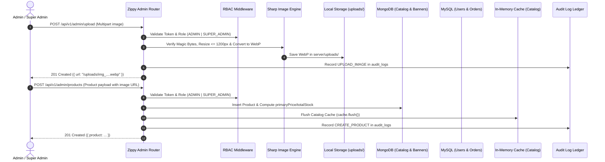
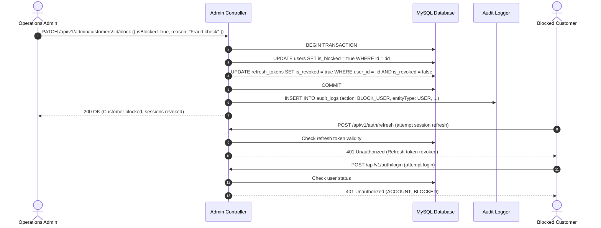

# Phase 6: Admin APIs & Backoffice Core

## Goal

Design, build, and verify the administrative and backoffice management engine for **Zippy**, ensuring complete oversight of quick-commerce operations:

1. **Administrative Dashboard (`/api/v1/admin/dashboard`):** Real-time aggregation of orders today, total/today revenue, active customer count, order status breakdown, and low-stock product/variant alerts.
2. **Product & Category CRUD (`/api/v1/admin/products`, `/api/v1/admin/categories`):**
   - Full create, update, soft-delete, and explicit inventory stock adjustment endpoints.
   - Dynamic synchronization with the in-memory catalog cache (`cache.flush()`) upon every mutation.
3. **Secure Media & Image Upload (`/api/v1/admin/upload`):**
   - Strict MIME-type allowlist (`image/jpeg`, `image/png`, `image/webp`) and 5MB size limit.
   - Stream validation and automatic resizing/optimization via Sharp to high-efficiency WebP.
   - Local filesystem storage (`uploads/`) in dev/test, architected for zero-code migration to S3/Cloudinary in production.
4. **Order, Customer, Coupon & Banner Management:**
   - **Orders (`/api/v1/admin/orders`):** Filterable, paginated orders with state machine transitions (`PLACED` &rarr; `PACKED` &rarr; `OUT_FOR_DELIVERY` &rarr; `DELIVERED`) and administrative cancellation with automated MongoDB inventory replenishment.
   - **Customers (`/api/v1/admin/customers`):** Customer search/inspection and account block/unblock toggles that immediately revoke all active refresh tokens in MySQL.
   - **Coupons (`/api/v1/admin/coupons`):** Full CRUD for promotional codes with usage tracking.
   - **Banners (`/api/v1/admin/banners`):** Full CRUD for hero promotional banners with display ordering.
5. **Security & Audit Trail (`/api/v1/admin/audit-logs`, `/api/v1/admin/login-logs`):**
   - Every single admin route protected by `requireAuth` and `requireRole('ADMIN', 'SUPER_ADMIN')`.
   - Immutable audit logging on every administrative mutation recording actor, target entity, and payload details.
   - Paginated viewers for both `audit_logs` and `login_logs`.

---

## Architecture & Workflows

### 1. Administrative Workflow & Cache Invalidation



### 2. Customer Blocking & Token Invalidation Flow



---

## API Endpoints Implemented

### 1. Dashboard Overview (`/api/v1/admin/dashboard`)

| Method | Endpoint                  | Access | Description                                                                         |
| ------ | ------------------------- | ------ | ----------------------------------------------------------------------------------- |
| `GET`  | `/api/v1/admin/dashboard` | Admin  | KPI metrics (orders today, revenues, customers, status breakdown, low stock alerts) |

### 2. Media Upload (`/api/v1/admin/upload`)

| Method | Endpoint               | Access | Description                                                                |
| ------ | ---------------------- | ------ | -------------------------------------------------------------------------- |
| `POST` | `/api/v1/admin/upload` | Admin  | Upload image (JPEG/PNG/WebP), process & resize with Sharp, save to storage |

### 3. Product & Inventory CRUD (`/api/v1/admin/products`)

| Method   | Endpoint                           | Access | Description                                                               |
| -------- | ---------------------------------- | ------ | ------------------------------------------------------------------------- |
| `GET`    | `/api/v1/admin/products`           | Admin  | List products with pagination, search, category, and availability filters |
| `POST`   | `/api/v1/admin/products`           | Admin  | Create product, compute primary price/stock, invalidate cache, log audit  |
| `GET`    | `/api/v1/admin/products/:id`       | Admin  | Get full product details by ID                                            |
| `PUT`    | `/api/v1/admin/products/:id`       | Admin  | Update product fields and invalidate catalog cache                        |
| `DELETE` | `/api/v1/admin/products/:id`       | Admin  | Soft-deactivate product (`isAvailable: false`) and invalidate cache       |
| `PATCH`  | `/api/v1/admin/products/:id/stock` | Admin  | Explicit stock adjustment for variant SKU, update totalStock, log audit   |

### 4. Category CRUD (`/api/v1/admin/categories`)

| Method   | Endpoint                       | Access | Description                                                       |
| -------- | ------------------------------ | ------ | ----------------------------------------------------------------- |
| `GET`    | `/api/v1/admin/categories`     | Admin  | List all categories (active and inactive)                         |
| `POST`   | `/api/v1/admin/categories`     | Admin  | Create category, invalidate cache, log audit                      |
| `PUT`    | `/api/v1/admin/categories/:id` | Admin  | Update category details and invalidate cache                      |
| `DELETE` | `/api/v1/admin/categories/:id` | Admin  | Soft-deactivate category (`isActive: false`) and invalidate cache |

### 5. Order Management (`/api/v1/admin/orders`)

| Method  | Endpoint                          | Access | Description                                                               |
| ------- | --------------------------------- | ------ | ------------------------------------------------------------------------- |
| `GET`   | `/api/v1/admin/orders`            | Admin  | List orders with status, date range, search filters, and customer details |
| `GET`   | `/api/v1/admin/orders/:id`        | Admin  | Full order detail view with items snapshot, payment, and addresses        |
| `PATCH` | `/api/v1/admin/orders/:id/status` | Admin  | Advance order status along validated state machine                        |
| `POST`  | `/api/v1/admin/orders/:id/cancel` | Admin  | Cancel order, refund payment if completed, replenish MongoDB inventory    |

### 6. Customer Management (`/api/v1/admin/customers`)

| Method  | Endpoint                            | Access | Description                                                         |
| ------- | ----------------------------------- | ------ | ------------------------------------------------------------------- |
| `GET`   | `/api/v1/admin/customers`           | Admin  | List customers with order count aggregation and search              |
| `GET`   | `/api/v1/admin/customers/:id`       | Admin  | Customer profile with recent orders and saved delivery addresses    |
| `PATCH` | `/api/v1/admin/customers/:id/block` | Admin  | Toggle block status; revokes all active refresh tokens when blocked |

### 7. Coupons & Banners CRUD (`/api/v1/admin/coupons`, `/api/v1/admin/banners`)

| Method   | Endpoint                    | Access | Description                                |
| -------- | --------------------------- | ------ | ------------------------------------------ |
| `GET`    | `/api/v1/admin/coupons`     | Admin  | List coupons with usage statistics         |
| `POST`   | `/api/v1/admin/coupons`     | Admin  | Create coupon in MySQL                     |
| `PUT`    | `/api/v1/admin/coupons/:id` | Admin  | Update coupon details                      |
| `DELETE` | `/api/v1/admin/coupons/:id` | Admin  | Delete coupon from MySQL                   |
| `GET`    | `/api/v1/admin/banners`     | Admin  | List hero promotional banners from MongoDB |
| `POST`   | `/api/v1/admin/banners`     | Admin  | Create hero banner                         |
| `PUT`    | `/api/v1/admin/banners/:id` | Admin  | Update hero banner                         |
| `DELETE` | `/api/v1/admin/banners/:id` | Admin  | Delete hero banner from MongoDB            |

### 8. Audit & Security Logs (`/api/v1/admin/audit-logs`, `/api/v1/admin/login-logs`)

| Method | Endpoint                   | Access | Description                                                               |
| ------ | -------------------------- | ------ | ------------------------------------------------------------------------- |
| `GET`  | `/api/v1/admin/audit-logs` | Admin  | Paginated audit log ledger (actor, action, entity, IP address, timestamp) |
| `GET`  | `/api/v1/admin/login-logs` | Admin  | Paginated authentication log ledger (email, success, failure reason, IP)  |

---

## Files Created & Modified

- `server/src/services/storage.service.js` &mdash; Multer memory storage, Sharp image processing/resizing, local storage engine.
- `server/src/validation/admin.validation.js` &mdash; Zod validation schemas for products, stock, categories, coupons, banners, orders, and customer blocking.
- `server/src/controllers/admin.controller.js` &mdash; Comprehensive controller implementing dashboard stats, CRUD operations, stock management, and log viewers.
- `server/src/routes/v1/admin.routes.js` &mdash; Admin router enforcing `requireAuth` and `requireRole('ADMIN', 'SUPER_ADMIN')`.
- `server/src/routes/v1/index.js` &mdash; Mounted admin router at `/api/v1/admin`.
- `server/src/app.js` &mdash; Mounted `/uploads` static file directory with cross-origin resource policy.
- `server/src/models/Product.js` &mdash; Hardened `pre('validate')` hook to preserve explicit `isAvailable: false`.
- `server/src/middleware/errorHandler.js` &mdash; Mapped Multer and file upload errors to HTTP 400.
- `server/src/docs/swagger.js` &mdash; OpenAPI 3.0 specification covering all Phase 6 admin endpoints.
- `server/tests/admin.test.js` &mdash; 25 automated Vitest unit/integration tests verifying security, CRUD, inventory adjustments, and uploads.
- `.gitignore` &mdash; Added ignore rules for uploaded media (`uploads/*`, `!uploads/.gitkeep`).

---

## Verification & Test Results

### 1. Automated Vitest Suite (`pnpm run test`)

```
✓ tests/App.test.jsx (2 tests) 291ms
✓ tests/database.test.js (11 tests) 2436ms
✓ tests/catalog.test.js (26 tests) 1469ms
✓ tests/auth.test.js (28 tests) 36709ms
✓ tests/order.test.js (18 tests) 5315ms
✓ tests/admin.test.js (25 tests) 5668ms

Test Files  6 passed (6)
Tests       112 passed (112)
Duration    47.77s
```

### 2. Code Quality & Linting (`pnpm run lint`)

```
$ pnpm -r lint
client lint: Done
server lint: Done
✖ 0 problems (0 errors, 0 warnings)
```

### 3. Live Development Smoke Test (`NODE_ENV=development`)

Executed live against running Node.js development server:

1. Health check confirmed operational (`/health` &rarr; 200).
2. Super Admin authenticated (`admin@zippy.com`).
3. Dashboard KPI metrics retrieved (revenue, orders, active customers, low-stock count).
4. Category created in MongoDB (`Live Smoke Groceries`).
5. Product created in MongoDB with variant stock; catalog cache invalidated.
6. Variant stock explicitly updated via `PATCH /products/:id/stock` &rarr; stock and totalStock synchronized.
7. Customer blocked via `PATCH /customers/:id/block` &rarr; verified `isBlocked: true` and active refresh tokens revoked in MySQL.
8. Customer unblocked on subsequent request.
9. Promotional coupon created in MySQL; hero banner created in MongoDB.
10. Audit log ledger inspected, confirming immutable audit entries for all operations.
11. Test entities cleaned up and background server terminated with zero orphan processes.
