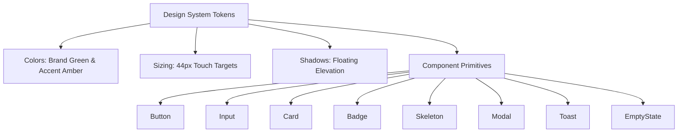
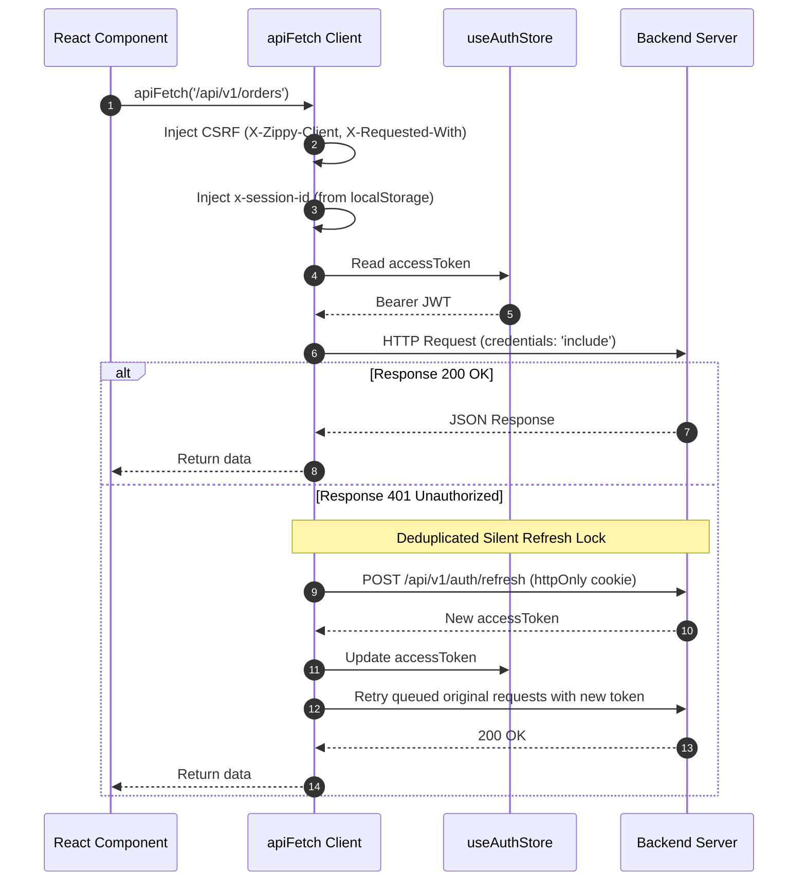

# Phase 7: Frontend Foundation and Design System

## 1. Executive Summary

Phase 7 establishes the frontend foundation for Zippy, a high-performance 10-minute quick-commerce web application. The frontend is built on **React 18.3**, **Vite 6.1**, **Tailwind CSS 3.4**, **Zustand 5.0**, **TanStack Query 5.66**, and **React Router 6.28**.

The design system is strictly tailored for quick commerce: mobile-first responsive layouts, large touch targets ($\ge 44\text{px}$), high-contrast readability, a primary emerald brand green (`#16a34a`) paired with a lightning amber accent (`#f59e0b`), generous whitespace, and zero heavy animations.

All 8 reusable accessible UI primitives, Zustand stores, route guards, error boundaries, the resilient API client with automated CSRF, guest session tracking, deduplicated silent token refresh, and full unit test coverage have been implemented and verified.

---

## 2. Design System & Theme Tokens

### 2.1 Theme Tokens Configuration

Tailwind configuration (`client/tailwind.config.js`) defines consistent tokens:

- **Brand Colors:** Full 50–950 emerald scale (`#16a34a` primary).
- **Accent Colors:** 50–900 amber scale (`#f59e0b` lightning accent).
- **Touch Target:** `min-w-touch` and `min-h-touch` (`44px` / `2.75rem`) enforcing mobile touch accessibility.
- **Elevation:** Soft floating shadows (`shadow-floating: 0 10px 25px -3px rgba(0, 0, 0, 0.08)`).
- **Typography:** Modern clean sans-serif system stack with strict hierarchy (max 2 font families).



---

## 3. Accessible UI Component Library

All primitives are located in `client/src/components/ui/` and exported via barrel `index.js`:

| Component        | Key Features & Accessibility                                                                                                                                                                                                                       |
| ---------------- | -------------------------------------------------------------------------------------------------------------------------------------------------------------------------------------------------------------------------------------------------- |
| **`Button`**     | 6 variants (`primary`, `secondary`, `accent`, `outline`, `ghost`, `danger`), 3 sizes (`sm`, `md`, `lg`), spinner loading state with `aria-busy="true"` and auto-disabled interaction, leading/trailing icon slots, $\ge 44\text{px}$ touch target. |
| **`Input`**      | Accessible label association (`id` / `htmlFor`), error validation state (`aria-invalid="true"` with `role="alert"`), helper text (`aria-describedby`), leading and trailing icon slots.                                                            |
| **`Card`**       | Modular composite system: `CardHeader`, `CardTitle`, `CardDescription`, `CardContent`, `CardFooter`.                                                                                                                                               |
| **`Badge`**      | 7 semantic styles (`brand`, `accent`, `success`, `warning`, `danger`, `neutral`, `outline`), 2 sizes, optional icon slot.                                                                                                                          |
| **`Skeleton`**   | Shimmer placeholder with `aria-hidden="true"` for smooth non-blocking content loading.                                                                                                                                                             |
| **`Modal`**      | Accessible dialog: backdrop blur, focus trap ref, `Escape` key listener, `aria-modal="true"`, `role="dialog"`, `aria-labelledby`, and body scroll lock.                                                                                            |
| **`Toast`**      | Dual component: `ToastItem` (accessible alert pill) and `ToastContainer` (`aria-live="polite"`), auto-dismissing notification toasts.                                                                                                              |
| **`EmptyState`** | Standard zero-state graphic with title, message, and call-to-action button.                                                                                                                                                                        |

---

## 4. API Client & Security Interceptor Architecture

The HTTP client in `client/src/services/api.js` connects the React frontend to the backend REST API:



### 4.1 Security & Session Features

1. **Credentials & Cookies:** `credentials: 'include'` on every request ensures the browser automatically transmits the `httpOnly` refresh token cookie without exposing it to client JavaScript.
2. **CSRF Prevention:** Custom headers `X-Zippy-Client: web` and `X-Requested-With: XMLHttpRequest` are automatically attached to all requests, fulfilling the Phase 3 backend CSRF defense.
3. **Guest Session Persistence:** `getGuestSessionId()` automatically generates and persists a unique `guest_<timestamp>_<random>` in `localStorage`. Passed as `x-session-id` on every request.
4. **Silent 401 Deduplication:** When multiple requests return 401 simultaneously, `isRefreshing` lock and `failedQueue` ensure only **one** `/api/v1/auth/refresh` request is dispatched. Queued requests await resolution and retry transparently.
5. **Cart Merge on Login:** `mergeGuestCart()` dispatches `POST /api/v1/cart/merge` with `guestSessionId`, merging unauthenticated cart items into the customer account, and resets the guest session key.

---

## 5. State Management, Routing & Layout

### 5.1 Zustand Stores

- **`useAuthStore`** (`client/src/stores/authStore.js`):
  - State: `user`, `accessToken`, `isAuthenticated`, `isLoading`.
  - Actions: `setAuth()`, `setAccessToken()`, `updateUser()`, `clearAuth()`, `hasRole(role)`.
  - Built-in role hierarchy: `SUPER_ADMIN` has access to all roles.
- **`useUIStore`** (`client/src/stores/uiStore.js`):
  - State: `toasts`, `deliveryPincode` (persisted in `localStorage`), `isPincodeModalOpen`, `isCartDrawerOpen`.
  - Actions: `addToast()`, `removeToast()`, `setPincode()`, `togglePincodeModal()`, `toggleCartDrawer()`.

### 5.2 TanStack Query Client

- Configured in `client/src/services/queryClient.js`:
  - `staleTime: 60_000` (1 minute for rapid inventory and catalog updates).
  - `gcTime: 600_000` (10 minutes garbage collection).
  - Client errors ($4\text{xx}$) are not retried.

### 5.3 Route Guards & Layouts

- **`ProtectedRoute`** (`client/src/components/auth/ProtectedRoute.jsx`): Redirects unauthenticated visitors to `/login`, preserving current path in state.
- **`RoleRoute`** (`client/src/components/auth/RoleRoute.jsx`): Restricts access to specific roles (`CUSTOMER`, `ADMIN`, `SUPER_ADMIN`).
- **`ErrorBoundary`** (`client/src/components/common/ErrorBoundary.jsx`): Gracefully handles render-time crashes with reload and home navigation options.
- **`RootLayout`** & **`PincodeModal`**:
  - Top `Header` with 10-minute delivery pill, live pincode selector trigger, mobile search bar, and cart drawer button.
  - Interactive `PincodeModal` supporting 6-digit Indian PIN input and one-click selection of major quick-commerce metro hubs (Bangalore: 560001, Mumbai: 400001, Delhi: 110001, Hyderabad: 500001, Pune: 411001).
  - Global `ToastContainer` for dismissible notifications.

---

## 6. Verification and Test Results

### 6.1 Client Test Suite

Executed with Vitest and `@testing-library/react`:

- `tests/components.test.jsx`: 13 tests covering Button, Input, Card, Badge, Skeleton, Modal, ToastItem, and EmptyState.
- `tests/stores.test.js`: 8 tests covering `useAuthStore` and `useUIStore`.
- `tests/routes.test.jsx`: 5 tests covering `ProtectedRoute` and `RoleRoute`.
- `tests/api.test.js`: 5 tests covering guest session ID generation, CSRF headers, Bearer tokens, and error parsing.
- `tests/App.test.jsx`: 2 tests covering Header and HomePage rendering.

**Client Vitest Result:**

```text
✓ tests/stores.test.js (8 tests)
✓ tests/api.test.js (5 tests)
✓ tests/routes.test.jsx (5 tests)
✓ tests/App.test.jsx (2 tests)
✓ tests/components.test.jsx (13 tests)

Test Files  5 passed (5)
     Tests  33 passed (33)
```

### 6.2 Full Monorepo Test Suite

Executed via `pnpm test`:

- **Server:** 6 test files, 112 tests passing.
- **Client:** 5 test files, 33 tests passing.
- **Total:** 11 test files, 145 tests passing.

### 6.3 Monorepo Linting

Executed via `pnpm lint`:

- Both `@zippy/server` and `@zippy/client` completed with **0 errors and 0 warnings**.

### 6.4 Production Build Verification

Executed via `pnpm --filter @zippy/client build`:

```text
vite v6.4.4 building for production...
✓ 1665 modules transformed.
dist/index.html                         0.69 kB │ gzip:  0.41 kB
dist/assets/index-DQYe2b2x.css         28.88 kB │ gzip:  5.65 kB
dist/assets/zap-CBf2pD8U.js             0.44 kB │ gzip:  0.31 kB
dist/assets/house-BTv2f7aR.js           0.46 kB │ gzip:  0.32 kB
dist/assets/NotFoundPage-D9zqQQof.js    1.32 kB │ gzip:  0.72 kB
dist/assets/HomePage-CiTXwTV8.js        5.56 kB │ gzip:  2.01 kB
dist/assets/RootLayout-DOp41zIo.js     21.88 kB │ gzip:  6.29 kB
dist/assets/index-n-Te3LsM.js         274.81 kB │ gzip: 88.41 kB
✓ built in 13.79s
```

Bundle size is minimal and code-split across lazy routes.

---

## 7. Security & Compliance Checklist

- [x] Zero hardcoded secrets, API keys, or credentials committed or documented.
- [x] Refresh tokens stored strictly in `httpOnly` SameSite cookies, never exposed to `localStorage` or `sessionStorage`.
- [x] CSRF protection enforced via custom header injection on all requests.
- [x] Accessible WCAG 2.1 AA touch targets ($\ge 44\text{px}$) and focus outlines implemented across interactive controls.
