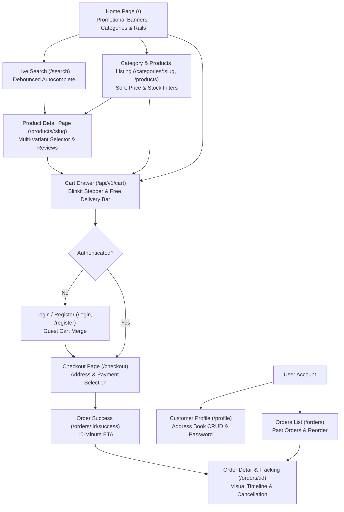

# Phase 8: Customer UI Implementation

## 1. Executive Summary

Phase 8 completes the end-to-end customer-facing user interface for Zippy, delivering a seamless 10-minute quick-commerce shopping experience. Built with **React 18.3**, **Tailwind CSS 3.4**, **TanStack Query 5.66**, **React Hook Form 7.54**, **Zod 3.24**, and **Zustand 5.0**, all customer pages, discovery tools, interactive cart steppers, secure authentication flows, and real-time order tracking timelines are fully implemented and verified.

The customer UI strictly adheres to quick-commerce best practices: mobile-first responsiveness (360px up to 4K displays), lightning-fast page transitions via React code-splitting, accessible touch targets ($\ge 44\text{px}$), high-contrast readability, emerald brand green (`#16a34a`) paired with warm amber accents (`#f59e0b`), and zero heavy layout shifts or blocking animations.

---

## 2. Customer Journey Architecture & Page Flow



---

## 3. Catalog, Discovery & Search Implementation

### 3.1 Home Page (`/`)

- Located in [`client/src/pages/HomePage.jsx`](file:///d:/Zippy/client/src/pages/HomePage.jsx).
- Wired to `GET /api/v1/home` via TanStack Query.
- Renders:
  - **Hero Banner:** Quick-commerce delivery promise with dark store instant dispatch notice.
  - **Static Promotional Banners:** Grid of curated deals with zero distracting autoplay carousels.
  - **Category Grid:** Visual category cards with responsive touch hover effects.
  - **Trending Essentials Rail:** Best-selling items in the local neighborhood with instant `ProductCard` steppers.
  - **Featured Category Rails:** Curated product rails for top grocery categories (Dairy, Fresh Produce, Snacks).
  - Shimmer skeletons displayed during query resolution.

### 3.2 Product & Category Listing (`/products`, `/categories/:slug`)

- Located in [`client/src/pages/ProductsPage.jsx`](file:///d:/Zippy/client/src/pages/ProductsPage.jsx).
- Wired to `GET /api/v1/categories` and `GET /api/v1/products`.
- Features:
  - Horizontal category pills bar with active pill highlighting.
  - 5-way sorting: Most Popular (`popular`), Price: Low to High (`price_asc`), Price: High to Low (`price_desc`), Highest Rated (`rating`), Newly Added (`newest`).
  - Filters sidebar: In-stock items toggle (`inStock=true`) and price range brackets (Under ₹50, ₹50–₹150, ₹150–₹300, Above ₹300).
  - Client pagination with Previous/Next controls and page indicators.
  - Empty state with filter reset action when no products match.

### 3.3 Live Search & Autocomplete (`/search`)

- Header search bar in [`client/src/components/common/Header.jsx`](file:///d:/Zippy/client/src/components/common/Header.jsx):
  - 200ms debounced query fetching suggestions from `GET /api/v1/search/suggestions?q=...`.
  - Dropdown surfaces matched category pills and product quick-links with prices.
- Search Results Page in [`client/src/pages/SearchPage.jsx`](file:///d:/Zippy/client/src/pages/SearchPage.jsx):
  - Wired to `GET /api/v1/search?q=...`.
  - Displays total matches found, query terms, sort selector, and responsive product grid.

### 3.4 Product Detail Page (`/products/:slug`)

- Located in [`client/src/pages/ProductDetailPage.jsx`](file:///d:/Zippy/client/src/pages/ProductDetailPage.jsx).
- Wired to `GET /api/v1/products/:slug`.
- Interactive Multi-Variant Selector:
  - Unit/weight selector pills (e.g. `500 ml` vs `1 L` or `250 g` vs `500 g`).
  - Selecting a variant dynamically recalculates live price, MRP, discount badge (`% OFF`), available stock, and updates the active SKU on the `AddToCartButton`.
- Image gallery with interactive thumbnails and responsive mobile zoom.
- 10-minute delivery guarantee banner displaying live dark store fulfillment promise.
- Product highlights, shelf life, country of origin, and customer review list with star ratings.

### 3.5 Pincode Serviceability Check

- Located in [`client/src/components/common/PincodeModal.jsx`](file:///d:/Zippy/client/src/components/common/PincodeModal.jsx).
- Wired to `GET /api/v1/serviceability/:pincode`.
- Displays real-time dark store hub details (e.g. _Zippy Koramangala Dark Store_), delivery ETA (10–12 minutes), or unserviceable expansion notice.
- Quick-select buttons for major quick-commerce hubs: Bengaluru (560001), Mumbai (400001), New Delhi (110001), Hyderabad (500001), Pune (411001).

---

## 4. Blinkit-Style Cart Stepper & Cart Drawer

### 4.1 Reusable `AddToCartButton` Stepper

- Located in [`client/src/components/common/AddToCartButton.jsx`](file:///d:/Zippy/client/src/components/common/AddToCartButton.jsx).
- State-driven interaction:
  - If item quantity is `0`: Renders high-contrast emerald `+ ADD` button with touch feedback.
  - If item quantity is `> 0`: Renders full Blinkit-style stepper `[-] [ qty ] [+]` with tactile feedback and keyboard accessibility.
  - Automatically respects variant stock limits, disabling increment when stock is exhausted.
  - If variant stock is `0`: Renders disabled `OUT OF STOCK` badge.

### 4.2 Reusable `ProductCard`

- Located in [`client/src/components/product/ProductCard.jsx`](file:///d:/Zippy/client/src/components/product/ProductCard.jsx).
- Includes lazy image with aspect-square container, discount badge, 10-minute delivery pill, brand name, clamped title, variant selector dropdown, price vs MRP comparison, and `AddToCartButton`.

### 4.3 Slide-Over `CartDrawer`

- Located in [`client/src/components/cart/CartDrawer.jsx`](file:///d:/Zippy/client/src/components/cart/CartDrawer.jsx).
- Global right slide-over panel connected to `useUIStore`:
  - **Free Delivery Progress Bar:** Tracks progress toward the ₹199 threshold (_"Add ₹X more for FREE delivery"_ or _"🎉 You've unlocked FREE delivery!"_).
  - **Itemized List:** Item image, title, variant unit, price, and instant stepper.
  - **Promo Coupon Engine:** Input field to apply promo codes (e.g. `WELCOME50`) or remove active coupons with real-time discount deduction.
  - **Bill Details Summary:** Item total (MRP), product discount, coupon savings, delivery fee, and grand total.
  - **Sticky Checkout CTA:** Displays total item count, total payable amount, and one-click navigation to `/checkout`.

---

## 5. Authentication & Profile Pages (React Hook Form + Zod)

### 5.1 Auth Suite

All forms use `react-hook-form` with `zodResolver`:

- **`LoginPage`** ([`client/src/pages/auth/LoginPage.jsx`](file:///d:/Zippy/client/src/pages/auth/LoginPage.jsx)): Email/password form, server error alerts, automatically triggers `mergeGuestCart()` upon successful login, and redirects to origin.
- **`RegisterPage`** ([`client/src/pages/auth/RegisterPage.jsx`](file:///d:/Zippy/client/src/pages/auth/RegisterPage.jsx)): Full name, email, 10-digit mobile number, and password policy validation (min 8 chars, numbers/special chars).
- **`ForgotPasswordPage`** ([`client/src/pages/auth/ForgotPasswordPage.jsx`](file:///d:/Zippy/client/src/pages/auth/ForgotPasswordPage.jsx)): Clean email submission with success state.
- **`ResetPasswordPage`** ([`client/src/pages/auth/ResetPasswordPage.jsx`](file:///d:/Zippy/client/src/pages/auth/ResetPasswordPage.jsx)): Token verification and password confirmation form.

### 5.2 Customer Profile & Address Book CRUD

- Located in [`client/src/pages/profile/ProfilePage.jsx`](file:///d:/Zippy/client/src/pages/profile/ProfilePage.jsx).
- Protected by `ProtectedRoute`.
- Features:
  - User details header and sign-out action.
  - **Saved Address Book:** Lists active delivery addresses with default indicators, delete button, and "+ Add New Address" modal supporting full Indian address formats (house no, street, city, state, 6-digit PIN).
  - **Security Tab:** Password change form calling `POST /api/v1/auth/change-password`.

---

## 6. Checkout, Payments & Order Tracking

### 6.1 Checkout Page (`/checkout`)

- Located in [`client/src/pages/checkout/CheckoutPage.jsx`](file:///d:/Zippy/client/src/pages/checkout/CheckoutPage.jsx).
- Protected by `ProtectedRoute`.
- Flow:
  1. **Address Selection:** Radio selector of saved delivery addresses or inline creation modal.
  2. **Payment Method Choice:** Cash on Delivery (`COD`) or Online Payment via Razorpay (`RAZORPAY`).
  3. **Idempotency Defense:** Automatically generates a client-side `idempotencyKey` preventing accidental double-billing on rapid clicks or network retries.
  4. **Order Creation:** Dispatches `POST /api/v1/orders/checkout`, invalidates active cart cache, and redirects to Order Success.

### 6.2 Order Success (`/orders/:orderId/success`)

- Located in [`client/src/pages/orders/OrderSuccessPage.jsx`](file:///d:/Zippy/client/src/pages/orders/OrderSuccessPage.jsx).
- Displays celebratory badge, order number, 10–12 minute delivery countdown, payment summary, and direct "Track Live Delivery" button.

### 6.3 Orders History (`/orders`)

- Located in [`client/src/pages/orders/OrdersListPage.jsx`](file:///d:/Zippy/client/src/pages/orders/OrdersListPage.jsx).
- Lists all active and past orders with status badges (`PLACED`, `PACKED`, `OUT_FOR_DELIVERY`, `DELIVERED`, `CANCELLED`), order date, item preview thumbnails, and tracking links.

### 6.4 Order Tracking & Cancellation (`/orders/:orderId`)

- Located in [`client/src/pages/orders/OrderDetailPage.jsx`](file:///d:/Zippy/client/src/pages/orders/OrderDetailPage.jsx).
- Features:
  - **Visual Status Timeline:** 4-step progress indicator (`PLACED` -> `PACKED` -> `OUT_FOR_DELIVERY` -> `DELIVERED`) with live 8-second polling until terminal status.
  - **Order Cancellation:** Customers can cancel orders while in `PLACED` or `PACKED` state with reason selection modal, automatically restoring MongoDB inventory.
  - **Immutable Item Snapshot:** Displays captured pricing, quantity, product image, and subtotal at the moment of checkout.
  - Delivery address snapshot and payment status badge.

---

## 7. Verification & Quality Assurance

### 7.1 Vitest Unit & Flow Test Results

- **Client Test Suites (`client/tests/`):**
  - `tests/customer.test.jsx`: 9 tests verifying `AddToCartButton` increment/decrement stepper, out-of-stock badge, `ProductCard` variant switching, `CartDrawer` items & free delivery progress bar, and `PincodeModal` live serviceability check.
  - `tests/components.test.jsx`: 13 tests covering design system primitives.
  - `tests/stores.test.js`: 8 tests covering `useAuthStore` and `useUIStore`.
  - `tests/routes.test.jsx`: 5 tests covering route guards.
  - `tests/api.test.js`: 5 tests covering API interceptors and guest session ID.
  - `tests/App.test.jsx`: 2 tests covering Header and HomePage.
  - **Client Total:** 6 test files, **42 tests passing**.
- **Monorepo Total (`pnpm test`):**
  - Server: 6 test files, **112 tests passing**.
  - Client: 6 test files, **42 tests passing**.
  - **Total:** 12 test files, **154 tests passing**.

```text
✓ tests/stores.test.js (8 tests)
✓ tests/api.test.js (5 tests)
✓ tests/routes.test.jsx (5 tests)
✓ tests/components.test.jsx (13 tests)
✓ tests/App.test.jsx (2 tests)
✓ tests/customer.test.jsx (9 tests)

Test Files  6 passed (6)
     Tests  42 passed (42)
```

### 7.2 Monorepo Linting

- Executed via `pnpm lint`:
  - `@zippy/server`: **0 errors, 0 warnings**.
  - `@zippy/client`: **0 errors, 0 warnings**.

### 7.3 Production Build Verification

- Executed via `pnpm --filter @zippy/client build`:
  - All 14 pages and modular components code-split into lazy-loaded chunks.
  - Main bundle size: **90.72 kB gzip**.
  - Build execution time: **16.33s**.

---

## 8. Security & Secret Safeguards

- [x] Zero passwords, tokens, or API credentials hardcoded or committed to git.
- [x] Authentication tokens strictly managed through `httpOnly` SameSite cookies and in-memory Zustand store.
- [x] All customer write operations protected against CSRF via automatic header injection.
