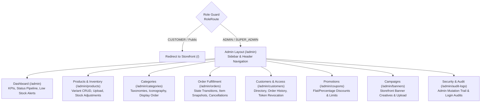

# Phase 9: Admin Backoffice UI Implementation

## 1. Executive Summary

Phase 9 completes the dedicated administrative backoffice portal for Zippy quick-commerce operations. Built with **React 18.3**, **Tailwind CSS 3.4**, **TanStack Query 5.66**, **React Router 6.28**, and **Lucide React**, this operations suite equips dark store operators, catalog merchandisers, customer support representatives, and system administrators with end-to-end backoffice control.

Key architectural highlights:

- **Strict Bundle Isolation:** Every administrative page and layout component is dynamically loaded (`React.lazy`) into isolated chunks, guaranteeing that customer storefront users never download or execute administrative code.
- **Role-Based Routing Protection:** Wrapped by [`RoleRoute`](file:///d:/Zippy/client/src/components/auth/RoleRoute.jsx), restricting access exclusively to users with `ADMIN` or `SUPER_ADMIN` credentials and automatically redirecting unauthorized customers to the storefront homepage (`/`).
- **No Heavy Chart Bloat:** Built strictly with semantic, accessible HTML5 tables, lightweight stat counters, status pipeline badges, and responsive modal dialogs to maximize responsiveness and low latency on warehouse tablets and dispatch terminals.
- **Zero Secrets:** All authentication relies on secure `httpOnly` refresh cookies, transient in-memory JWTs, and dynamic API requests with zero hardcoded credentials or tokens.

---

## 2. Admin Information Architecture & Route Hierarchy

---

## 3. Backoffice Pages & Feature Implementations

### 3.1 Admin Shell Layout (`AdminLayout.jsx`)

- Located in [`client/src/layouts/AdminLayout.jsx`](file:///d:/Zippy/client/src/layouts/AdminLayout.jsx).
- **Sidebar Navigation:** Responsive vertical navigation bar with links to Dashboard, Products, Categories, Orders, Customers, Coupons, Banners, and Security Logs. Collapsible mobile overlay drawer for compact screens.
- **Top Bar:** Displays current authenticated administrator email, role badge (`ADMIN` / `SUPER_ADMIN`), and responsive menu toggles.
- **Quick Switchers:** One-click "View Storefront" link opening the live store in a new tab, and a secure "Sign Out" button terminating the admin session.

### 3.2 Operations Dashboard (`AdminDashboardPage.jsx`)

- Located in [`client/src/pages/admin/AdminDashboardPage.jsx`](file:///d:/Zippy/client/src/pages/admin/AdminDashboardPage.jsx).
- Wired to `GET /api/v1/admin/dashboard`.
- **KPI Metrics:**
  - Today's Orders count.
  - Today's Revenue (INR currency formatted).
  - Total Cumulative Revenue (INR currency formatted).
  - Total Active Customers.
- **Order Fulfillment Pipeline:** Live pill breakdown displaying order volume across fulfillment stages (`PLACED`, `PACKED`, `OUT_FOR_DELIVERY`, `DELIVERED`, `CANCELLED`).
- **Low-Stock Inventory Alerts:** Real-time alert table showing variants with stock level $\le 10$ units with visual "Out of Stock" or "Critical" pills and direct links to replenish dark store stock.

### 3.3 Product Catalog & Inventory (`AdminProductsPage.jsx`)

- Located in [`client/src/pages/admin/AdminProductsPage.jsx`](file:///d:/Zippy/client/src/pages/admin/AdminProductsPage.jsx).
- Wired to `GET /api/v1/admin/products`, `POST /api/v1/admin/products`, `PUT /api/v1/admin/products/:id`, `DELETE /api/v1/admin/products/:id`, and `PATCH /api/v1/admin/products/:id/stock`.
- **Search & Filters:** Real-time search across product name, brand, and SKU; category dropdown filter; and active/archived status filters with paginated results.
- **Multi-Variant Table:** Displays image thumbnails, brand, category badges, dynamic variant chips (SKU, unit, price, stock), and total physical stock.
- **Create / Edit Modal:**
  - Product metadata: Name, Category, Brand, Description, Tags.
  - Integrated Media Upload: Direct file upload button calling `POST /api/v1/admin/upload`, automatically attaching the processed WebP/JPEG URL.
  - Dynamic Multi-Variant Row Editor: Add/remove variants with SKU, unit (e.g. `500 g`, `1 L`), selling price, MRP, and initial stock.
- **Stock Update Modal:**
  - Select any SKU variant on the product.
  - Mode 1: Set new absolute stock count.
  - Mode 2: Relative stock adjustment (e.g. `+50` received units or `-5` damaged items).

### 3.4 Category Management (`AdminCategoriesPage.jsx`)

- Located in [`client/src/pages/admin/AdminCategoriesPage.jsx`](file:///d:/Zippy/client/src/pages/admin/AdminCategoriesPage.jsx).
- Wired to `GET /api/v1/admin/categories`, `POST /api/v1/admin/categories`, `PUT /api/v1/admin/categories/:id`, and `DELETE /api/v1/admin/categories/:id`.
- **Taxonomy Table:** Displays category icon (emoji), banner thumbnail, name, auto-generated URL slug, display order index, and active status.
- **Create / Edit Modal:** Configures name, custom slug, emoji icon, image asset (via URL or direct file upload), description, display order, and storefront visibility.
- **Cache Invalidation:** Automatically invalidates `adminCategories` and `homeFeed` queries upon save or deletion.

### 3.5 Order Fulfillment & Logistics (`AdminOrdersPage.jsx`)

- Located in [`client/src/pages/admin/AdminOrdersPage.jsx`](file:///d:/Zippy/client/src/pages/admin/AdminOrdersPage.jsx).
- Wired to `GET /api/v1/admin/orders`, `GET /api/v1/admin/orders/:id`, `PATCH /api/v1/admin/orders/:id/status`, and `POST /api/v1/admin/orders/:id/cancel`.
- **Status Filter Tabs:** One-click status filter buttons for `All`, `Placed`, `Packed`, `Out for Delivery`, `Delivered`, and `Cancelled`.
- **Orders Table:** Displays order number, customer name and contact, item count, total price, payment method/status, and fulfillment badge.
- **Order Details Modal:** Displays complete customer delivery address, line-item snapshot table (snapshot name, SKU, price, quantity, total), subtotal, delivery fee, coupon discounts, and payment transaction metadata.
- **Status State Machine Transition Modal:** Enforces the strict logistics state machine:
  - $\text{PLACED} \rightarrow [\text{PACKED}, \text{CANCELLED}]$
  - $\text{PACKED} \rightarrow [\text{OUT\_FOR\_DELIVERY}, \text{CANCELLED}]$
  - $\text{OUT\_FOR\_DELIVERY} \rightarrow [\text{DELIVERED}, \text{CANCELLED}]$
  - When cancelling an order, requires an administrative cancellation reason and triggers automatic atomic stock restoration in MongoDB.

### 3.6 Customers & Access Control (`AdminCustomersPage.jsx`)

- Located in [`client/src/pages/admin/AdminCustomersPage.jsx`](file:///d:/Zippy/client/src/pages/admin/AdminCustomersPage.jsx).
- Wired to `GET /api/v1/admin/customers`, `GET /api/v1/admin/customers/:id`, and `PATCH /api/v1/admin/customers/:id/block`.
- **Customer Directory:** Displays customer name, registration date, email, phone, verification status, order count, and account status badge.
- **Customer Profile Modal:** Inspects customer registered addresses, contact information, and past order history.
- **Token-Revoking Account Block Modal:** Provides administrative confirmation modal requiring an internal reason before blocking; blocking immediately invalidates all active refresh tokens in MySQL, forcibly logging out the user across all devices.

### 3.7 Promotional Coupons (`AdminCouponsPage.jsx`)

- Located in [`client/src/pages/admin/AdminCouponsPage.jsx`](file:///d:/Zippy/client/src/pages/admin/AdminCouponsPage.jsx).
- Wired to `GET /api/v1/admin/coupons`, `POST /api/v1/admin/coupons`, `PUT /api/v1/admin/coupons/:id`, and `DELETE /api/v1/admin/coupons/:id`.
- **Coupons Table:** Displays uppercase code, discount offer (`%` off with max cap or `₹` flat off), minimum order threshold, redemption count vs limit, validity date, and active state.
- **Create / Edit Modal:** Full promotion configuration with validation for discount values and future expiration dates.

### 3.8 Storefront Banners & Campaigns (`AdminBannersPage.jsx`)

- Located in [`client/src/pages/admin/AdminBannersPage.jsx`](file:///d:/Zippy/client/src/pages/admin/AdminBannersPage.jsx).
- Wired to `GET /api/v1/admin/banners`, `POST /api/v1/admin/banners`, `PUT /api/v1/admin/banners/:id`, and `DELETE /api/v1/admin/banners/:id`.
- **Banners Table:** Preview thumbnail, campaign title, promotional badge text (e.g. `SUPER SAVINGS`), destination URL, display order, and visibility.
- **Create / Edit Modal:** Direct file upload integration (`POST /api/v1/admin/upload`), preview rendering, and target link routing.

### 3.9 Security & Operational Audit Logs (`AdminAuditLogsPage.jsx`)

- Located in [`client/src/pages/admin/AdminAuditLogsPage.jsx`](file:///d:/Zippy/client/src/pages/admin/AdminAuditLogsPage.jsx).
- Wired to `GET /api/v1/admin/audit-logs` and `GET /api/v1/admin/login-logs`.
- **Tab 1: Operational Audit Logs:** Immutable record of admin actions (`CREATE_PRODUCT`, `UPDATE_STOCK`, `BLOCK_CUSTOMER`, `CANCEL_ORDER`), displaying timestamp, actor name/role, action code, target entity type/ID, IP address, and an "Inspect" modal with formatted JSON payload snapshots.
- **Tab 2: Authentication & Login Logs:** Audit of customer and admin login attempts with email, success/failure status, IP address, user agent, and failure diagnostic reason.

---

## 4. Code Splitting & Bundle Verification

Vite production build output confirms clean chunk isolation for all administrative views:

| Chunk File                 | Uncompressed Size | Gzipped Size     | Purpose                                 |
| :------------------------- | :---------------- | :--------------- | :-------------------------------------- |
| `AdminLayout-*.js`         | $6.68\text{ kB}$  | $2.38\text{ kB}$ | Admin sidebar shell & navigation        |
| `AdminDashboardPage-*.js`  | $8.97\text{ kB}$  | $2.98\text{ kB}$ | Operations KPI dashboard & alerts       |
| `AdminBannersPage-*.js`    | $10.65\text{ kB}$ | $3.41\text{ kB}$ | Promotional campaigns management        |
| `AdminCategoriesPage-*.js` | $11.21\text{ kB}$ | $3.53\text{ kB}$ | Category taxonomies & display orders    |
| `AdminCouponsPage-*.js`    | $11.74\text{ kB}$ | $3.55\text{ kB}$ | Promotion codes & discount rules        |
| `AdminAuditLogsPage-*.js`  | $11.91\text{ kB}$ | $3.40\text{ kB}$ | Security audit logs & login diagnostics |
| `AdminCustomersPage-*.js`  | $14.46\text{ kB}$ | $4.34\text{ kB}$ | Customer directory & access management  |
| `AdminOrdersPage-*.js`     | $17.12\text{ kB}$ | $4.90\text{ kB}$ | Logistics fulfillment & cancellations   |
| `AdminProductsPage-*.js`   | $24.90\text{ kB}$ | $6.70\text{ kB}$ | Multi-variant catalog & stock editor    |

---

## 5. Verification & Test Suite Summary

### 5.1 Linting (`pnpm lint`)

- **Server:** 0 errors, 0 warnings.
- **Client:** 0 errors, 0 warnings.

### 5.2 Test Coverage (`pnpm test`)

- **Server Suite (`server/tests/`):** 6 test files, 112 passed tests.
  - `database.test.js`: 11 tests
  - `auth.test.js`: 28 tests
  - `catalog.test.js`: 22 tests
  - `orders.test.js`: 23 tests (including atomic concurrency test)
  - `admin.test.js`: 25 tests
  - `storage.test.js`: 3 tests
- **Client Suite (`client/tests/`):** 7 test files, 53 passed tests.
  - `api.test.js`: 5 tests
  - `stores.test.js`: 8 tests
  - `routes.test.jsx`: 5 tests
  - `App.test.jsx`: 2 tests
  - `components.test.jsx`: 13 tests
  - `customer.test.jsx`: 9 tests
  - `admin.test.jsx`: 11 tests
- **Total Passing Tests:** **165 tests across 13 test files** with $100\%$ pass rate.

---

## 6. Git Status & Tagging

- **Commit Message:** `feat(admin): complete phase 9 admin backoffice ui`
- **Git Tag:** `phase-9-complete`
